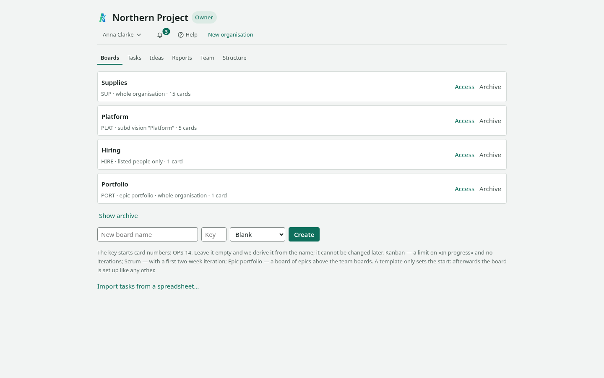
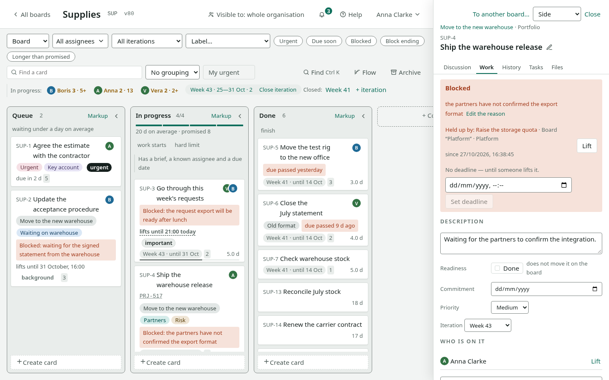

# First fifteen minutes

Walk this path once and the board will stop needing explanations. We
will create a board, put work on it, carry that work to the end, and
invite a colleague.

You need a board open in a browser and fifteen minutes.

**The interface speaks English and Russian;** the language is chosen
behind your name in the header. Buttons are named here as they appear
in the English interface.

## 1. Create a board

1. On the main screen, type a name into **New board name**.
2. Next to it, in **Key**, type a short word — `ПОСТ`, say. It
   becomes the prefix of card numbers: ПОСТ-1, ПОСТ-2. Leave it empty
   and we derive it from the name.
3. In **How we work**, leave **Blank** or pick **Kanban** (a soft limit
   of 3 on **In progress**, no iterations), **Scrum** (a first
   two-week iteration from today) or **Epic portfolio** (a board of
   epics above the team boards).
4. Press **Create**.

The board opens straight away with three columns: **Queue**,
**In progress**, **Done**. Those are stages of work,
and you can change them. The template only sets the start: afterwards
the board is set up like any other.

## 2. Put work on it

1. Press **+** next to the **Queue** heading, or **Create card** at the bottom of the column.
2. Write what needs doing and press `Enter`. If you already know who
   will do it, pick them under the title — **Assignee…**; the choice
   stays for the next card, so a batch for one person takes one pick.

Create three or four cards: with one, the board shows nothing.

## 3. Move a card

Drag a card into **In progress**. Or, faster: focus it from the keyboard
and press `Ctrl` with the right arrow.

The card flashes in its new place — that is how the board shows where
it went. Everyone with this board open sees the change immediately.

## 4. Describe the work

1. Click the card's title; a panel opens.
2. The current column, due date, assignees and completion control are visible above the tabs. To move the card, choose another column there. Go to **Work** to edit its properties.
3. Assign an owner, set an estimate and a due date.

If work has stalled, press **Block** and write the
reason. The reason shows on the board itself: "blocked" with no
explanation answers no question at all. If you know when the wait
ends, fill in **Lifts itself (optional)** — the block lifts
itself at that moment.

To mark what kind of work it is, add a label: hover the card, press the
label icon in its bottom right corner and type. A label that does not exist yet is created right there —
for this board, a subdivision, or the whole organisation.

On the board, a block appears immediately below the title. Labels use
small coloured dots so they do not compete with warnings. Age is shown
as text; the progress bar measures completion only.

The open card's **…** menu contains its link, transfer to another board,
archive and permanent deletion where permitted. Archiving can be undone;
permanent deletion requires confirmation.

**Filter** reveals the filter conditions on every screen. Its count and
the number of hidden cards remain visible while collapsed.

On a computer, compact cards keep the complete title, assignees, the main
warning, priority, due date, age and progress visible. The title wraps
without truncation. Use the arrow on a card to expand its description
and additional properties directly on the board; other cards stay compact.
Use the same arrow to collapse it. Hover for a warning's full text.

The checkbox selects cards for bulk actions; it does not expand them.
Selection and the actions menu appear on hover, keyboard focus or while
selecting cards, with no floating panel over the card's contents.
Enable **Tools** → **Detailed cards** to show additional properties on all
cards; that choice is remembered in this browser.

**Column rules** under a column heading reveals its flow markers and entry policy.

**Tools** reveals grouping, saved views, flow, archive,
workload and iterations. Search, filtering and column switching remain
available while the tools are collapsed. To close an iteration, open
its **…** menu.

Click a parent task above a subtask’s title to open its Tasks tab, with all accessible direct subtasks and the source subtask highlighted. **Return to subtask** restores the original card and list filters, including when the parent is on another board. Access permissions remain unchanged.

## 5. Carry it to the end

Move the card into **Done**. After a few such cards, open **Flow**
in the board header: cycle time, throughput and a forecast
appear there. The metrics are computed from what you have already
done — nothing to invent.

## 6. Invite a colleague

1. Open the **Team** tab.
2. Under **Invite**, enter an e-mail and pick a role.
3. Press **Invite** and send the link that appears.

The link is addressed: someone with a different e-mail cannot accept
it. It is shown once — only a fingerprint of it is stored.

## What next

- Solve a specific problem — [How to](howto.md).
- See everything as a list — [Reference](reference.md).
- Understand why the board works this way — [Design
  decisions](architecture.md).
