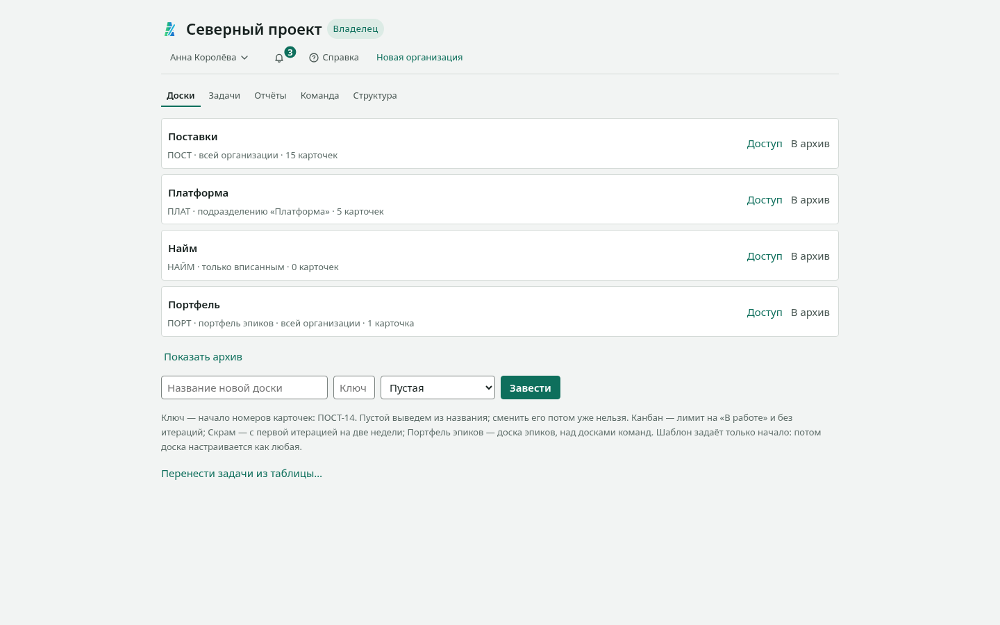
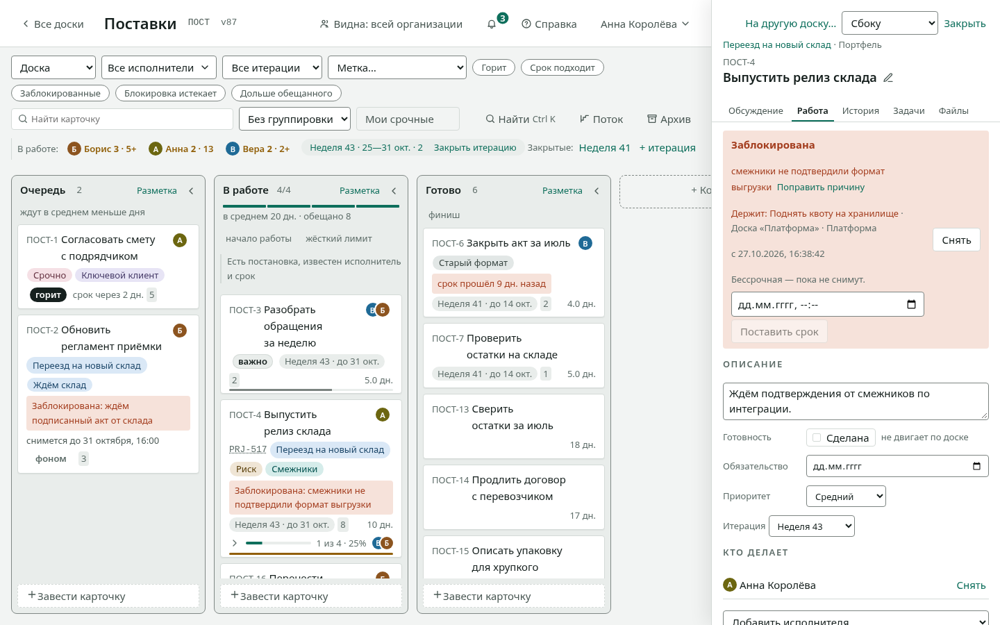

# Первые пятнадцать минут

Пройдите этот путь один раз — и дальше доска не будет требовать
объяснений. Мы заведём доску, поставим на неё работу, проведём её
до конца и позовём коллегу.

Вам понадобится открытая доска в браузере и пятнадцать минут.

## 1. Заведите доску

1. На главном экране введите название в поле **«Название новой доски»**.
2. Рядом, в поле **«Ключ»**, введите короткое слово — например, `ПОСТ`.
   Оно станет началом номеров карточек: ПОСТ-1, ПОСТ-2. Оставите
   пустым — выведем из названия.
3. В списке **«Как работаем»** оставьте **«Пустая»** или выберите
   **«Канбан»** (мягкий лимит 3 на «В работе», без итераций),
   **«Скрам»** (первая итерация на две недели с сегодняшнего дня) или
   **«Портфель эпиков»** (доска эпиков над досками команд).
4. Нажмите **«Завести»**.

Доска откроется сразу. В ней уже есть три колонки: «Очередь»,
«В работе», «Готово». Это стадии работы, и их можно менять. Шаблон
задаёт только начало: дальше доска настраивается как любая другая.

## 2. Поставьте работу

1. Нажмите **«+»** возле заголовка «Очередь» или **«Завести карточку»** внизу колонки.
2. Напишите, что нужно сделать, и нажмите `Enter`. Если уже известно,
   кто будет делать, выберите его под названием — **«Исполнитель…»**;
   выбор остаётся для следующей карточки, и пачка на одного человека
   стоит одного выбора.

Заведите три-четыре карточки: на одной доска ничего не показывает.

## 3. Перенесите карточку

Возьмите карточку мышью и перетащите в «В работе». Или, что быстрее:
встаньте на неё с клавиатуры и нажмите `Ctrl` со стрелкой вправо.

Карточка вспыхнет на новом месте — так доска показывает, куда она
уехала. Изменение сразу увидят все, у кого открыта эта доска.

## 4. Опишите работу подробнее

1. Щёлкните по названию карточки — откроется панель.
2. Колонка, срок, исполнители и отметка готовности видны над вкладками. Чтобы перенести карточку, выберите там другую колонку. Для изменения свойств перейдите на вкладку **«Работа»**.
3. Назначьте исполнителя, поставьте оценку и срок.

Если работа встала — нажмите **«Заблокировать»** и напишите причину.
Причина будет видна прямо на доске: «заблокирована» без объяснения
не отвечает ни на один вопрос. Если известно, когда ожидание кончится,
заполните **«Снимется само (необязательно)»** — в этот момент блокировка
снимется сама.

Чтобы отметить, что это за работа, повесьте метку: наведите на карточку,
нажмите значок метки в её правом нижнем углу и начните набирать. Метку, которой ещё нет, заведёте прямо
там — для этой доски, подразделения или всей организации.

На доске блокировка показана сразу под названием. Цвет меток
сохранён в небольших точках, чтобы они не спорили с предупреждениями.
Возраст показан текстом; полоса прогресса измеряет только готовность.

В меню **«…»** открытой карточки находятся ссылка, перенос на другую
доску, архивация и окончательное удаление при наличии прав. Архивацию
можно отменить; окончательное удаление требует подтверждения.

Кнопка **«Отбор»** раскрывает условия на любом экране. При свёрнутых
условиях остаются счётчик отбора и число скрытых карточек.

На компьютере компактные карточки показывают полное название,
исполнителей, главное предупреждение, приоритет, срок, возраст и прогресс.
Название переносится без обрезки. Стрелка на карточке раскрывает её
описание и дополнительные свойства прямо на доске; соседние карточки
остаются компактными. Повторное нажатие сворачивает подробности.
Полный текст предупреждения доступен при наведении.

Чекбокс выбирает карточки для массовых действий и не раскрывает их.
Выбор и меню действий появляются при наведении, фокусе с клавиатуры
или выделении карточек, без плавающей плашки поверх содержимого.
Включите **«Инструменты»** → **«Подробные карточки»**, чтобы показать
дополнительные свойства у всех карточек; выбор запоминается в браузере.

**«Правила колонки»** под заголовком раскрывают признаки потока и правило входа.

Кнопка **«Инструменты»** раскрывает группировку, сохранённые
виды, поток, архив, загрузку и итерации. Поиск, отбор и переключение
колонок доступны и при свёрнутых инструментах. Чтобы закрыть итерацию,
откройте её меню **«…»**.

Нажмите на основную задачу над названием подзадачи: откроется вкладка «Задачи» со всеми доступными прямыми подзадачами и выделенной исходной. «Вернуться к подзадаче» возвращает прежнюю карточку и отбор списка, в том числе при переходе между досками. Права доступа не меняются.

## 5. Доведите до конца

Перенесите карточку в «Готово». Через несколько таких карточек
откройте **«Поток»** в шапке доски: там появятся время цикла,
пропускная способность и прогноз. Метрики считаются из того, что вы
уже сделали, — придумывать ничего не нужно.

## 6. Позовите коллегу

1. Откройте вкладку **«Команда»**.
2. В разделе **«Пригласить»** введите почту и выберите роль.
3. Нажмите **«Пригласить»** и отправьте появившуюся ссылку.

Ссылка адресная: человек с другим адресом её не примет. Показывается
она один раз — в базе хранится только отпечаток.

## Что дальше

- Решить конкретную задачу — [«Как сделать»](как.md).
- Посмотреть все возможности списком — [«Справочник»](справочник.md).
- Понять, почему доска устроена именно так, — [«Устройство»](устройство.md).

<!-- перевод: docs/quickstart.md sha256:02489ebbf94b -->
